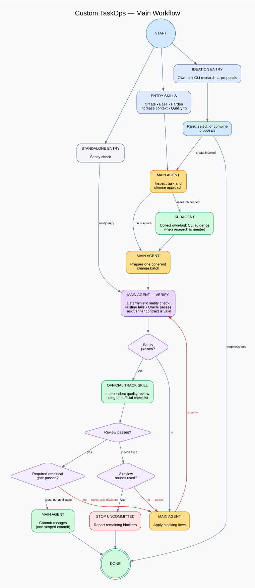

# custom-taskops

Benchmark-task workflow for Muse (Muse Spark). The main agent owns
task creation and edits; expensive failure research runs in
context-isolated subagents that return compact actionable briefs. Task reviews
use the track's official review skill directly.



## Layout

- `skills/` — entry points: `create-task`, `ideate-task`,
  `ease-task`, `harden-task`, `quality-fix`,
  `sanity-check`, `increase-context-tokens`.
- `agents/` — subagent definitions: `failure-researcher`,
  `quality-issue-researcher`, `context-researcher`. Addressed as
  `custom-taskops/<name>` when registered by the runtime. Use
  `references/researcher-dispatch.md` for named-agent, general-subagent, and
  inline routes when bundled definitions are not registered.
- `profiles/` — one track profile per task type, detected at runtime
  (see `profiles/README.md`). Profiles carry layout, verifier, metadata,
  review routing, scratch paths, and optional context targets.
- `hooks/` — `task-gate.sh`: fast non-blocking Stop hook. Silent unless
  task files changed; reports structure/metadata status and whether the
  change affects documentation or substantive task content.
- `references/` — shared rules loaded on demand: `model-role.md` (1P
  authorship authority), `instruction-style.md` (stylometric rules), and
  `commit-workflow.md` (single commit after review passes), plus
  `runtime-discovery.md` (schema, routing, and cache drift policy) and
  `iterate-review.md` (the canonical validation/review loop),
  `difficulty-strategy.md` (deliberate initial difficulty bias), and
  `ideation-to-creation.md` (automatic proposal composition), plus
  `difficulty-source-discovery.md` (CLI-only own-task discovery),
  `existing-task-validity.md` (exact-content baseline reuse),
  `difficulty-calibration.md` and `context-calibration.md` (empirical
  operation gates), and `hardening-calibration.md` (concrete failure transfer
  and measured three-attempt calibration).
- `.muse-plugin/plugin.json` — native manifest (skills + hooks).

## How a task operation flows

1. Skill starts; runtime sources are resolved per
   `references/runtime-discovery.md`, then the fingerprinted research cache is
   checked.
2. On a miss, the main agent spawns a researcher subagent and caches the brief.
3. Task edits follow `references/iterate-review.md`: an exact-content evidence
   baseline (full sanity when required), edits, post-edit sanity, independent
   review, and every review fix back through sanity.
4. Loop budget: max 3 review rounds, then escalate to the user.
5. When the official review and empirical gates pass, one commit per the commit workflow (`references/commit-workflow.md`); on rejection or escalation, leave the tree uncommitted.

Invoking `create-task` without a concrete idea automatically composes both
entry points: ideation supplies and ranks proposals, combining multiple strong
failure modes by default while preserving their failure-inducing cores;
creation alone owns scaffolding, validation, review, and the final commit. See
`references/ideation-to-creation.md` and `references/difficulty-strategy.md`.
All researchers use the Codimango CLI and limit remote task discovery and
hydration to tasks owned by the currently authenticated user:

```sh
codimango task list --filter mine --track <track> --limit 50 --sort updated-at --dir desc --json
```

Failure research, context growth, and quality repair share this ownership scope.
Discovery uses the CLI's existing authentication and never opens or drives a
browser. On an authentication failure, the workflow reports the error and asks
the user to run `codimango auth setup`. Each operation fetches a fresh bounded
own-task listing and fingerprints its scope and candidate revisions before
reusing a research brief. Sparse or empty own-task history is reported;
ideation can continue from the user's seed and local context with explicitly
labeled hypotheses. Hardening and context growth can use current-task evidence
and local reasoning while retaining their empirical gates.

Hardening additionally mines a bounded set of the user's recent difficult
tasks, selecting from own-task CLI evidence. It carries
forward concrete source mechanics,
invariants, verifier structure, and trajectory evidence without verbatim reuse,
records provenance and substantial transformations, explicitly reviews
contamination/originality/embedding-dedup risk, and runs up to three five-trial
local calibration attempts. It commits only after the configured difficulty
target and the ordinary sanity/review gates pass.
For an unchanged task with complete exact-current-content platform evidence,
hardening uses a cheap pre-edit validity preflight instead of rerunning the full
sanity suite; every post-edit attempt still receives the full sanity gate.
Context growth uses the same own-task CLI discovery and validity
preflight, but ranks source tasks by measured peak-token use, long trajectories,
late failures, and legitimate cross-file/tool/state dependencies rather than by
pass rate alone. Easing, hardening, and context growth commit only after their
shared empirical gates pass; own-source dossiers accompany independent
review for provenance and originality assessment.
Quality repair likewise collects Codimango's exact-current-commit evidence
before deciding whether a local baseline run is needed; complete platform
failures become repair inputs, while every repaired task still receives full
post-edit sanity and review.

Review checklists, blocking criteria, and output formats come from the current
official track skill. Difficulty is empirical (codimango CI trials), never
asserted by the gate.

Codimango stages, rubric items, taxonomy values, model ids, and official skill
names are deliberately not closed lists here. Exact-commit platform results and
current official routing take precedence over profile hints.

## Install

On each machine:

```sh
muse plugins install /path/to/custom-taskops --scope user
muse plugins approve custom-taskops
```

## Troubleshooting

Skills missing in a spun agent? Run this, then restart the agent
session:

```sh
for H in ~/.agent-conductor/default/muse-homes/*/; do
  HOME=$H XDG_DATA_HOME=${H}data XDG_CONFIG_HOME=${H}config \
    muse plugins install /path/to/custom-taskops --scope user >/dev/null 2>&1
  HOME=$H XDG_DATA_HOME=${H}data XDG_CONFIG_HOME=${H}config \
    muse plugins approve custom-taskops >/dev/null 2>&1
done
```

## Requirements

- `codimango` CLI on PATH (failure research, oracle runs where applicable).
- Python 3 (the non-blocking Stop hook).
- Current official Team AAI skills for review and task README generation.
- Per-track verifier where runnable (`harbor`, docker, or track tooling).
- Trusted workspace so project files load.

## Author identity

Resolve author identity from the task repo's configuration or explicit user
input. Repo-specific paths stay in each task repo's `AGENTS.md` adapter.

## Verification and track support

```sh
muse plugins validate . --json
python3 -m unittest discover -s tests
```

TBench has a concrete profile. Android is a stub; SWE-bench and long-horizon
need the capabilities listed in their profiles supplied by a current official
source or the task repo's adapter. A valid plugin manifest does not establish
that every track workflow is runnable.

See [the plugin audit](docs/plugin-audit.md) for fixes, verification, and runtime
limits.
